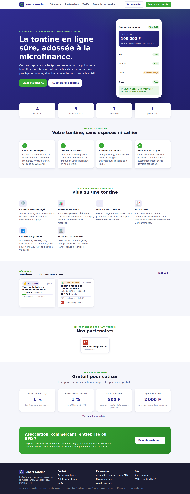
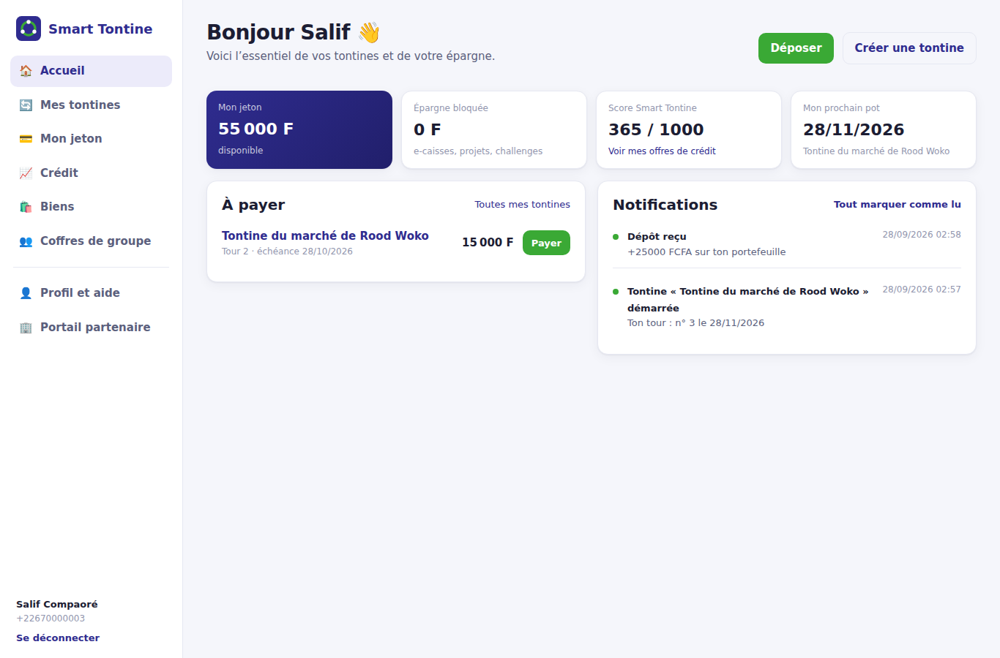
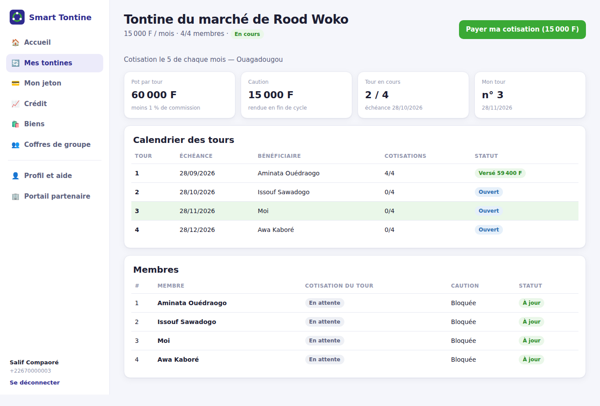
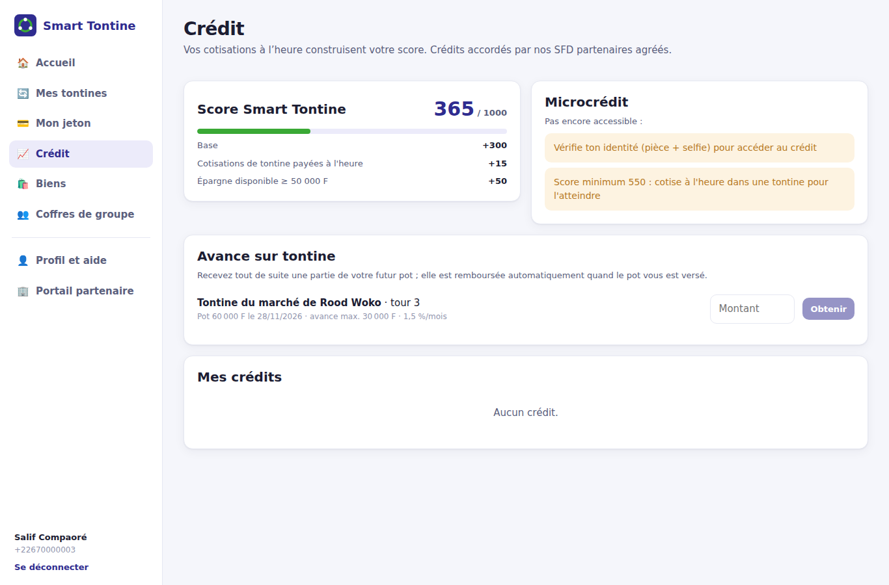
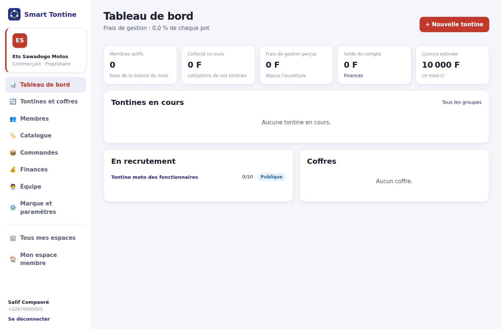
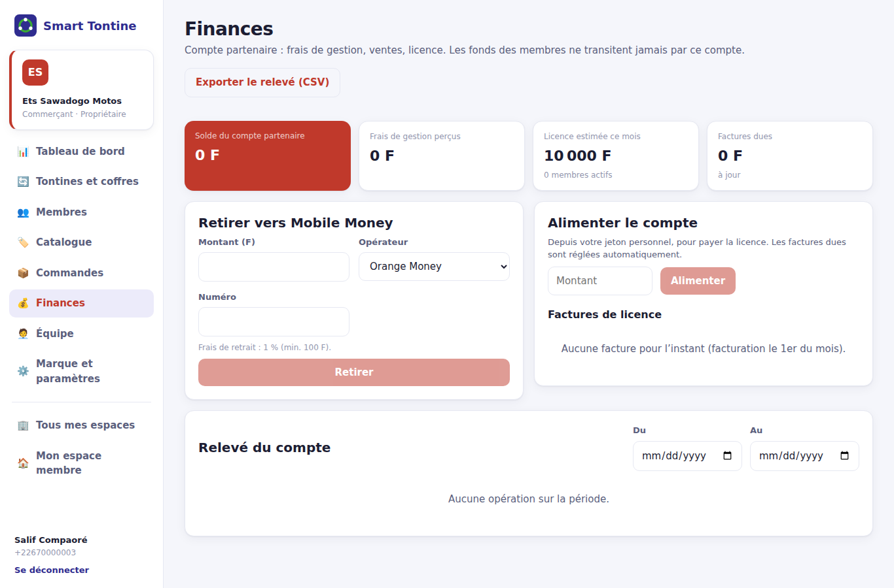
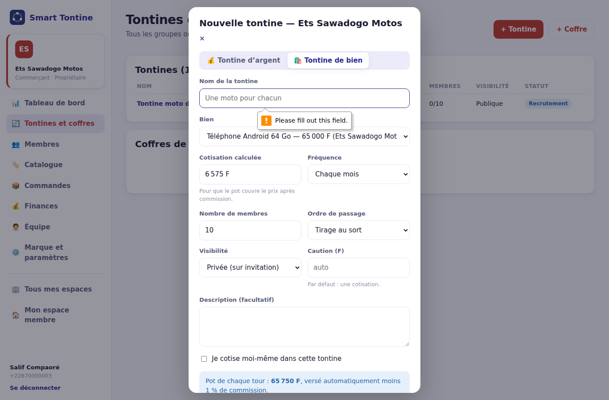
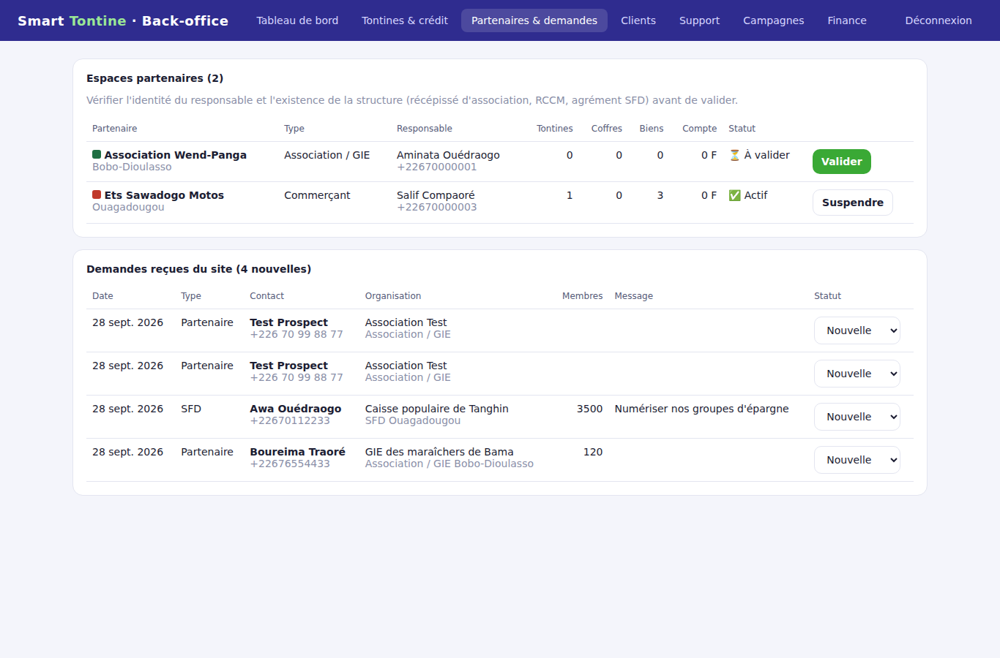

# 10. Architecture technique

Complément du [cahier des charges](09_cahier_des_charges.md). Ce chapitre décrit **comment les plateformes sont construites, reliées et déployées**.

## 10.1 Vue d'ensemble

```
                         ┌──────────────────────────── Utilisateurs ────────────────────────────┐
                         │  Membres · Organisateurs · Partenaires · Visiteurs · Équipe interne  │
                         └───────┬──────────────────────┬─────────────────────────┬────────────┘
                                 │                      │                         │
                ┌────────────────▼───────┐  ┌───────────▼────────────┐  ┌─────────▼──────────┐
                │ App mobile (Expo / RN) │  │ Plateforme web (React) │  │ Back-office /admin │
                │ Android · iOS          │  │ site public            │  │ HTML + JS          │
                │ SecureStore, QR, photo │  │ espace membre          │  │ CRM, crédit, KYB,  │
                │                        │  │ portail partenaire     │  │ demandes, finance  │
                └────────────────┬───────┘  └───────────┬────────────┘  └─────────┬──────────┘
                                 │ HTTPS / JSON (jeton Bearer)                    │
                         ┌───────▼────────────────────────────────────────────────▼───────┐
                         │ Reverse proxy / WAF (TLS, limitation de débit globale)          │
                         │ nginx : fichiers web statiques + relais des routes de l'API     │
                         └───────┬─────────────────────────────────────────────────────────┘
                                 │
      ┌──────────────────────────▼──────────────────────────┐        ┌────────────────────────────┐
      │ API Smart Tontine — Node.js 22 / Express 5 (N inst.) │◄──────►│ Worker (1 instance)        │
      │ /public  /auth  /wallet  /tontines  /credit  /goods  │        │ mêmes modules, RUN_JOBS    │
      │ /partners  /cagnottes  /me  /admin/api  /webhooks    │        │ tours échus, prélèvements, │
      │ Zod · JWT · PIN · limitation de débit · Helmet       │        │ rappels, e-caisse, Pro/Plus│
      └───────┬───────────────────────────┬──────────────────┘        │ commandes, licences        │
              │ SQL paramétré              │ HTTPS                    └──────────────┬─────────────┘
      ┌───────▼────────────────┐   ┌──────▼──────────────────────────────────┐       │
      │ PostgreSQL 16          │   │ Intégrations                            │       │
      │ grand livre en partie  │   │ • agrégateur Mobile Money (collecte,    │◄──────┘
      │ double, contraintes,   │   │   payout, webhooks HMAC)                │
      │ sauvegardes PITR       │   │ • SMS (OTP, rappels) • SFD (crédit)     │
      └────────────────────────┘   └─────────────────────────────────────────┘
```

**Principes**
1. **Une seule API** pour toutes les interfaces. Aucune règle métier n'est codée dans les interfaces : elles affichent ce que l'API calcule, y compris les tarifs, qui sont lus sur `/public/pricing`.
2. **Un seul grand livre** : tout mouvement d'argent est une transaction équilibrée (`services/ledger.ts`).
3. **API sans état** : la session est un jeton signé, relu en base à chaque requête. On ajoute des instances derrière le proxy sans rien changer.
4. **Tâches planifiées isolées** dans un worker unique (`RUN_JOBS=true`), pour ne jamais débiter deux fois.
5. **Même domaine** pour le site et l'API en production. Il n'y a donc pas de CORS à ouvrir, les cookies tiers ne posent pas de problème et la configuration reste simple.

## 10.2 Composants

| Composant | Dossier | Technologies | Rôle |
|---|---|---|---|
| API | `backend/src` | Node.js 22, TypeScript, Express 5, Zod 4, `pg` | Règles métier, sécurité, grand livre |
| Base | `backend/migrations` | PostgreSQL 16, migrations SQL versionnées (`001` à `007`) | Données et intégrité |
| Worker | `backend/src/jobs.ts` | Même image que l'API | Tâches horaires |
| **Plateforme web** | `web/` | React 19, TypeScript, Vite 8, React Router 7 | Site public, espace membre, portail partenaire |
| App mobile | `mobile/` | Expo SDK 57, React Native 0.86, Expo Router | Membres, organisateurs, partenaires |
| Back-office | `backend/public/admin` | HTML + JS sans dépendance | Équipe Smart Tontine |
| Tests | `backend/tests`, `web/src/**/*.test.ts(x)` | Vitest, Supertest, Testing Library | 41 tests API de bout en bout + tests web |

### Plateforme web (`web/`)

| Zone | Routes | Accès |
|---|---|---|
| Site public | `/`, `/decouvrir`, `/partenaires`, `/partenaires/:id`, `/tarifs`, `/devenir-partenaire`, `/rejoindre/:code`, `/legal` | Libre, via l'API `/public/*` |
| Connexion | `/connexion` (OTP SMS, puis création du PIN) | Libre |
| Espace membre | `/app`, `/app/tontines(/:id)`, `/app/portefeuille`, `/app/credit`, `/app/biens`, `/app/coffres(/:id)`, `/app/profil` | Connecté |
| Portail partenaire | `/partenaire`, `/partenaire/:id` + `groupes`, `membres`, `catalogue`, `commandes`, `finances`, `equipe`, `parametres` | Équipe du partenaire. Finances, équipe et marque : propriétaire uniquement (contrôlé aussi par l'API) |

Choix de conception :
- **Chargement à la demande** : le site public se charge d'abord (≈ 107 Ko gzip). L'espace membre et le portail partenaire ne se chargent qu'à la connexion.
- **Couleur du partenaire** appliquée au portail et aux groupes via la variable CSS `--accent`.
- **Code PIN** saisi dans une fenêtre dédiée (`useUi().askPin`) et jamais conservé.
- **Logos et photos** recadrés et compressés dans le navigateur (≤ 300 Ko) avant l'envoi.
- **Exports CSV** téléchargés avec le jeton de session (`download()`).

### API publique (sans compte) — `modules/public.ts`

| Route | Usage |
|---|---|
| `GET /public/pricing` | Grille tarifaire (site, app) |
| `GET /public/stats` | Chiffres clés agrégés (aucune donnée personnelle) |
| `GET /public/tontines`, `GET /public/tontines/:id` | Tontines publiques, aperçu d'une invitation |
| `GET /public/goods` | Catalogue |
| `GET /public/partners`, `GET /public/partners/:id` | Vitrines des partenaires |
| `POST /public/leads` | « Devenir partenaire / SFD », contact (pot de miel anti-robots, 5 envois / heure / IP) |

### Nouvelles routes du portail partenaire et du back-office

| Route | Droits |
|---|---|
| `GET /partners/:id/members` | Équipe : membres, groupes, retards, défaillances, montants cotisés |
| `GET /partners/:id/goods` | Équipe : catalogue complet, y compris les biens retirés |
| `GET /partners/:id/statement[?from&to]`, `GET /partners/:id/statement.csv` | Propriétaire : relevé avec solde après chaque opération |
| `GET/PATCH /admin/api/leads` | Support / admin : suivi des demandes (nouvelle, contactée, signée, perdue) |
| `POST /wallet/deposits/:reference/simulate` | **Démo uniquement** (fournisseur simulé, hors production) |

## 10.3 Sécurité

| Menace | Parade | Où |
|---|---|---|
| Vol de compte par SMS | OTP à 6 chiffres haché, 5 min, 5 essais, 5 demandes / 15 min | `modules/auth.ts` |
| Force brute sur le PIN | **Verrouillage 30 min après 5 erreurs**, notification au membre, compteur remis à zéro au succès | `assertPin` |
| Rafales de requêtes | Limitation par IP : `/auth` 30 / min, `/public` 120 / min, formulaire 5 / h. Limite globale au proxy / WAF | `lib/rateLimit.ts` |
| Blanchiment | Plafond de solde **et plafond mensuel de dépôts** par niveau KYC | `modules/wallet.ts`, `pricing.limits` |
| Double débit | Verrous `FOR UPDATE` dans un ordre fixe ; contrainte `CHECK (balance >= 0)` | `services/ledger.ts` |
| Faux webhook | HMAC-SHA256 en temps constant, dépôt idempotent | `modules/webhooks.ts` |
| Élévation de droits | Rôle relu en base à chaque requête ; droits partenaire vérifiés côté serveur (`assertStaff`) | `lib/auth.ts`, `services/partners.ts` |
| Injection | Requêtes paramétrées, validation Zod de toutes les entrées | partout |
| Clickjacking, MIME | Helmet (API), en-têtes nginx (`X-Frame-Options`, `nosniff`) | `app.ts`, `web/nginx.conf` |
| Jeton volé sur mobile | Keychain / Keystore (`expo-secure-store`) | `mobile/src/lib/api.ts` |

À ajouter avant l'ouverture au public :
- 2FA pour le back-office ;
- vérification serveur-à-serveur des paiements auprès de l'agrégateur ;
- CSP stricte sur le site ;
- test d'intrusion externe ;
- journalisation centralisée.

## 10.4 Environnements et déploiement

| Environnement | Composition | Paiements | Données |
|---|---|---|---|
| **Développement** | `npm run dev` (API) + `npm run dev` (web, relais Vite vers l'API) + Expo | Simulés (`PAYMENT_PROVIDER=mock`), OTP affiché | `npm run seed` |
| **Pré-production** | `docker compose` ou cloud identique à la production | Agrégateur en mode test | Anonymisées |
| **Production** | Proxy/WAF → nginx (web) → N × API + 1 worker → PostgreSQL managé | Agrégateur réel, vérification serveur-à-serveur | Réelles, sauvegardes PITR 30 j |

**Conteneurs**
- `backend/Dockerfile` : image de l'API, également utilisée pour le worker (`RUN_JOBS=true`).
- `web/Dockerfile` : build Vite puis nginx (`web/nginx.conf`), qui relaie les routes de l'API. En variante sans nginx, l'API sert elle-même `web/dist` (variable `WEB_DIST`) avec repli sur `index.html`.
- `docker-compose.yml` : `db`, `api`, `worker`, `web`. Démarrage avec `docker compose up -d --build`, puis ouvrir http://localhost:8080.

**Application mobile** (`mobile/eas.json`)

| Profil | Distribution | API |
|---|---|---|
| `development` | Interne | IP du poste de développement |
| `preview` | APK interne pour la bêta fermée | Pré-production |
| `production` | Play Store / App Store (`eas build -p all --profile production`, puis `eas submit`) | Production |

- L'adresse de l'API est fixée par `EXPO_PUBLIC_API_URL` dans chaque profil. Les domaines inscrits sont des exemples, à remplacer par les vrais.
- Les correctifs sont publiés à distance par `eas update --channel production`.

**Intégration continue** (`.github/workflows/ci.yml`), bloquante sur chaque push :
- **API** : PostgreSQL de test, `typecheck`, puis les 41 tests de bout en bout ;
- **web** : tests puis build ;
- **mobile** : vérification des types.

## 10.5 Exploitation

| Sujet | Mise en œuvre |
|---|---|
| Santé | `GET /health` (sonde du proxy et de Docker) |
| Intégrité financière | Back-office → Finance → Contrôle du grand livre, **chaque jour** (alerte si `somme ≠ 0`) |
| Rapprochement | Retraits « à rapprocher » dans le back-office ; relevés opérateurs ↔ transactions |
| Tâches | Worker horaire ; en cas d'arrêt, la reprise est sûre car chaque tâche est idempotente et ne traite que les éléments échus non traités |
| Montée en charge | Ajouter des instances d'API (`RUN_JOBS=false`) ; PostgreSQL : index existants, réplique en lecture pour le back-office si besoin |
| Sauvegardes | PostgreSQL managé, point-in-time 30 jours ; test de restauration trimestriel |

## 10.6 Démarrer la plateforme complète en local

```bash
# 1. Base de données
docker compose up -d db                  # ou un PostgreSQL 16 local

# 2. API + back-office (+ tâches planifiées)
cd backend && cp .env.example .env && npm install && npm run seed && npm run dev
#    http://localhost:4000/admin  (admin de démo : +22670000000, code OTP affiché)

# 3. Plateforme web (site public, espace membre, portail partenaire)
cd ../web && npm install && npm run dev  # http://localhost:5173
#    ou : npm run build → servie directement par l'API sur http://localhost:4000

# 4. Application mobile
cd ../mobile && npm install && npx expo start
```

Comptes de démonstration (connexion par OTP, code affiché à l'écran en développement) :

| Numéro | Profil |
|---|---|
| `+22670000003` | Propriétaire de l'espace commerçant « Ets Sawadogo Motos » (validé) |
| `+22670000001` | Membre, propriétaire de l'association « Wend-Panga » (en attente de validation) |
| `+22670000000` | Administrateur |

## 10.7 Captures de la plateforme web

| | |
|---|---|
| Site public  | Espace membre  |
| Fiche tontine  | Crédit  |
| Portail partenaire  | Finances partenaire  |
| Tontine de bien d'un partenaire  | Back-office : demandes  |
