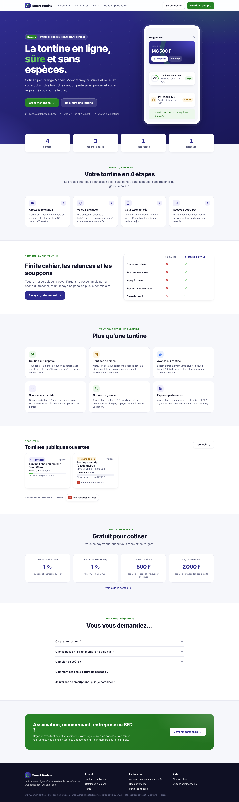
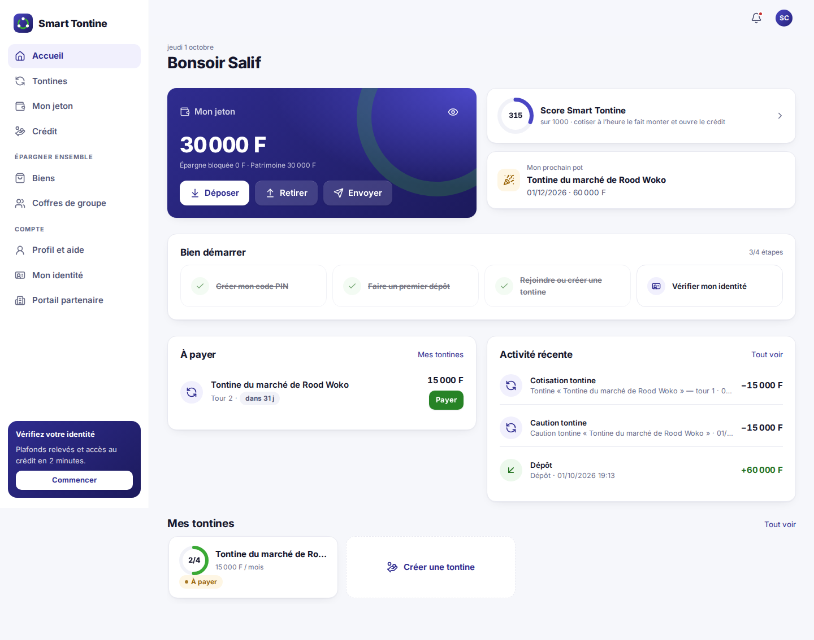
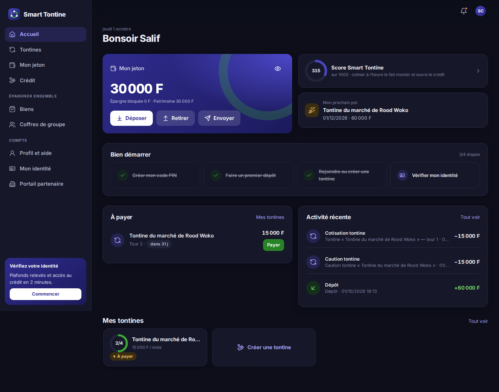
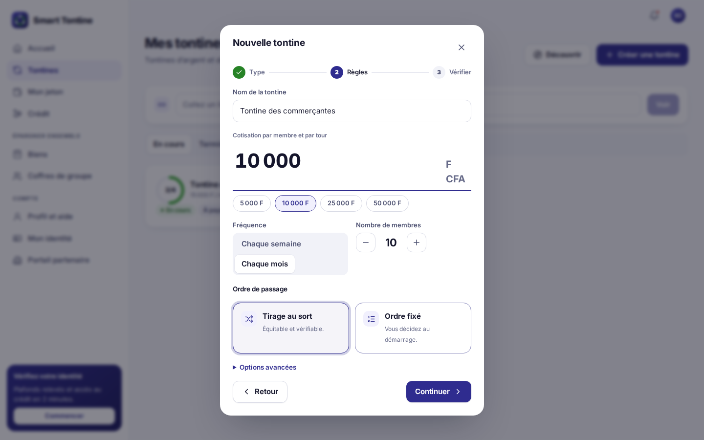
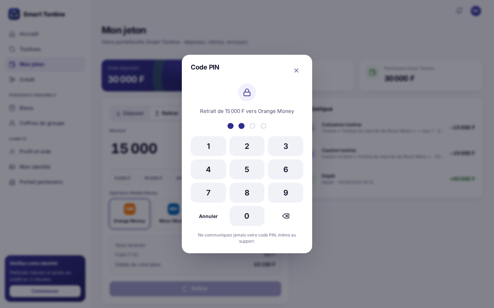
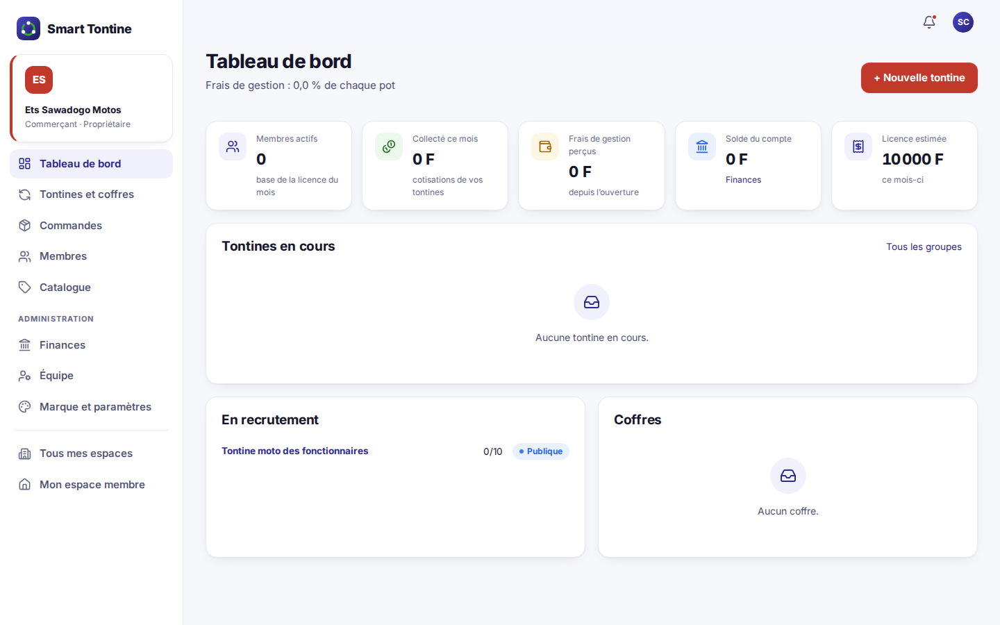
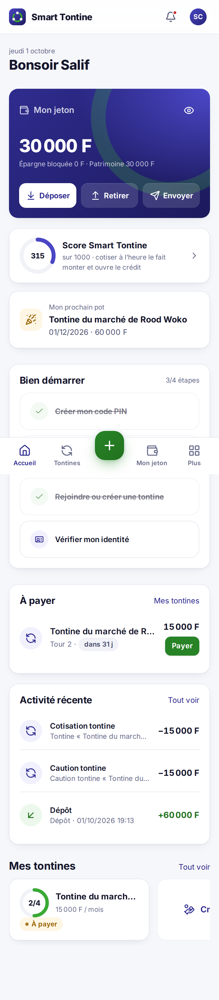
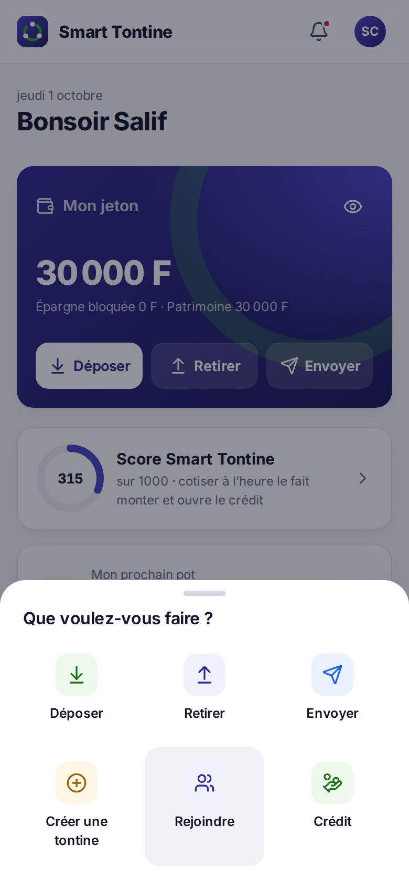
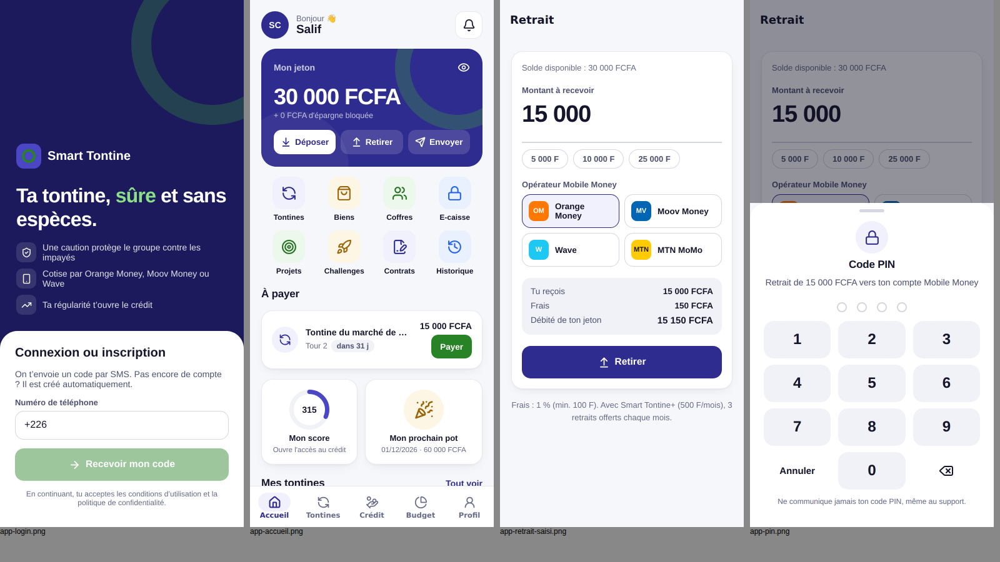
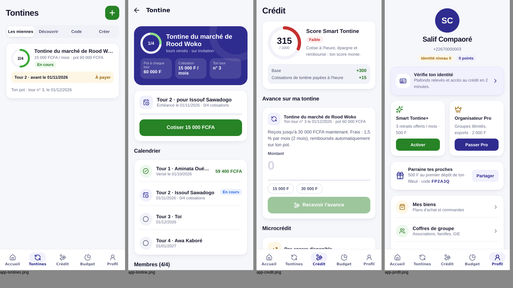

# 11. Design UX/UI — application et plateforme web

> Objectif : une interface **moderne, rassurante et simple**, utilisable par une commerçante du marché comme par un trésorier d'association ou un gestionnaire de SFD, sur un téléphone d'entrée de gamme comme sur un ordinateur.

## 11.1 Principes

| Principe | Ce que cela veut dire concrètement |
|---|---|
| **1. L'argent d'abord, en grand** | Le solde et les montants sont les éléments les plus visibles. Chiffres tabulaires, séparateur des milliers, « F CFA ». Le solde peut être **masqué** d'un geste (œil). |
| **2. Une action principale par écran** | Un seul bouton plein par écran (Déposer, Payer, Créer…). Les actions secondaires sont des boutons clairs ou des liens. |
| **3. Montrer avant de valider** | Chaque sortie d'argent affiche un **récapitulatif** (montant, frais, total débité) avant le **code PIN**. Aucun frais n'est découvert après coup. |
| **4. Le temps, en mots** | « demain », « dans 3 j », « en retard de 2 j » plutôt qu'une date seule. Couleur : neutre, puis orange, puis rouge. |
| **5. Guider les nouveaux** | Parcours « Bien démarrer » (PIN, premier dépôt, première tontine, identité). Chaque liste vide explique quoi faire et propose le bouton pour le faire. |
| **6. Le moins de saisie possible** | Montants rapides (5 000, 10 000…), choix visuel de l'opérateur, nombre de membres par « + / − », création de tontine en 3 étapes, PIN sur un **clavier** et non au clavier du téléphone. |
| **7. Confiance** | Fonds cantonnés, caution, tirage vérifiable : rappelés à l'accueil, à la connexion et avant l'adhésion. Pas de jargon financier. |
| **8. Accessible** | Contrastes AA, zones tactiles ≥ 44 px, focus visible au clavier, libellés pour les lecteurs d'écran, animations réduites si le système le demande. |

## 11.2 Identité visuelle

| Élément | Valeur | Usage |
|---|---|---|
| Indigo Smart Tontine | `#2F2C8F` (et nuances `#4A46C4`, `#1C1A5C`) | Marque, actions principales, solde |
| Vert « argent » | `#3AA935` | Gain, dépôt, paiement, succès |
| Or | `#F0A92B` / texte `#9A6406` | Pot, biens, alertes douces |
| Rouge | `#D63B3B` | Retard, impayé, erreur |
| Fond / surfaces | `#F6F7FB` / `#FFFFFF` | Fond légèrement bleuté, cartes blanches |
| Encre | `#15162C`, secondaire `#4E5272`, discret `#868AA6` | Textes |
| Typographie web | **Inter** (variable, auto-hébergée, ~50 Ko) | Lisible, chiffres alignés |
| Typographie app | Police native (Roboto / SF) | Aucun téléchargement, rendu parfait des graisses sur Android |
| Icônes | **Lucide** (trait 2 px, même jeu sur web et app) | Remplacent tous les émojis |
| Rayons | 10 / 16 / 22 / 28 px | Champs, cartes, fenêtres, grands blocs |
| Couleur des partenaires | Couleur choisie par le partenaire, appliquée à son portail et à ses groupes | Marque blanche |

**Mode sombre** (web) : automatique selon le téléphone ou l'ordinateur, ou au choix (Clair / Sombre / Auto) dans le menu du compte. Tous les composants lisent les mêmes jetons de couleur (`web/src/styles.css`), redéfinis pour le sombre.

## 11.3 Navigation

| Support | Navigation |
|---|---|
| **App mobile** | 5 onglets à icônes (Accueil, Tontines, Crédit, Budget, Profil) ; onglet actif dans une pastille. Raccourcis en grille sur l'accueil. |
| **Web — téléphone** | Barre d'onglets en bas : Accueil, Tontines, **bouton d'action central** (Déposer, Retirer, Envoyer, Créer une tontine, Rejoindre, Crédit), Mon jeton, Plus. |
| **Web — ordinateur** | Menu latéral groupé (Principal, Épargner ensemble, Compte) + barre supérieure : **cloche des notifications**, choix du thème, menu du compte. |
| **Portail partenaire** | Même structure, aux couleurs du partenaire ; compteur des commandes à expédier dans le menu. |

## 11.4 Bibliothèque de composants

| Composant | Web (`web/src/components/ui.tsx`) | App (`mobile/src/components/ui.tsx`) |
|---|---|---|
| Bouton (plein, vert, doux, contour, danger ; avec icône ; état « en cours ») | `Button` | `Button` |
| Saisie de montant en grand + montants rapides | `AmountInput` | `AmountInput` |
| Choix de l'opérateur Mobile Money (pastilles aux couleurs des opérateurs) | `OperatorPicker` | `ChannelPicker` |
| Clavier PIN (4 points, pavé numérique, effacement) | `useUi().askPin` | `usePin()` : crée le PIN sur place s'il n'existe pas |
| Récapitulatif avant validation | `Recap` (portefeuille) | `Recap` |
| Anneau de progression (tours, score) | `Ring` | `Ring` |
| Pastille d'icône colorée | `Ico` | `IconBadge` |
| Ligne de liste (icône, titre, sous-titre, montant) | `TxRow`, `.list-row` | `ListItem`, `HistoryRow` |
| Badge d'état | `Badge` | `Badge` |
| État vide (icône, titre, conseil, action) | `EmptyState` | `EmptyState` |
| Chargement | `Skeleton` / `Loading` (squelettes animés) | indicateur natif |
| Encadré d'information | `Notice` (info, attention, succès) | cartes colorées |
| Étapes d'un parcours | `.steps` (création de tontine) | — |
| Fenêtre / feuille | `Modal`, feuille du bas sur téléphone | feuille coulissante (PIN) |

## 11.5 Parcours clés

| Parcours | Avant | Après |
|---|---|---|
| **Payer sa cotisation** | Ouvrir la tontine, chercher le tour | Bouton **Payer** directement dans « À payer » sur l'accueil, avec compte à rebours |
| **Retirer** | Champs texte, PIN tapé au clavier | Montant en grand + montants rapides → opérateur en un toucher → récapitulatif (frais, total) → **clavier PIN** |
| **Créer une tontine** | Un long formulaire | **3 étapes** : type (argent / bien, privée / publique, en cartes) → règles (montant, fréquence, « + / − » membres, tirage) → **vérification chiffrée** (pot, durée, caution, commission) |
| **Premier usage** | Écran vide | Parcours « Bien démarrer » en 4 étapes cochées automatiquement |
| **Comprendre son score** | Un chiffre | Anneau coloré + niveau (En construction / Bon / Excellent) + détail des points |
| **Rejoindre** | Code à recopier | Lien, QR code ou WhatsApp → aperçu clair (cotisation, pot, caution) → un bouton |

## 11.6 Captures

**Plateforme web**

| | |
|---|---|
| Site public  | Espace membre  |
| Mode sombre  | Création de tontine (étape 2/3)  |
| Clavier PIN  | Portail partenaire  |
| Sur téléphone  | Bouton d'action central  |

**Application mobile**

## 11.7 Contrôles qualité effectués

- **20 pages web** vérifiées à 390 px de large (téléphone) : aucun débordement horizontal.
- Parcours complets rejoués dans un navigateur : connexion, dépôt, retrait avec PIN, création de tontine, portail partenaire. Aucune erreur dans la console.
- Typage strict (TypeScript) du web et de l'app ; tests web et API au vert.
- Bundle web initial : environ 115 Ko compressés, sous l'objectif de 250 Ko du cahier des charges (NF-04).

## 11.8 Pistes suivantes

1. **Tests utilisateurs** au marché de Rood Woko et avec une association : 5 personnes suffisent à révéler la plupart des blocages. Mesures : temps pour payer une cotisation, erreurs de PIN, abandons.
2. **Langues locales** (mooré, dioula) et **messages vocaux** pour les personnes peu lettrées.
3. **Mode sombre** dans l'app mobile, en reprenant les mêmes jetons.
4. Maquettes Figma de référence à partir de ces écrans, pour l'équipe et les partenaires.
5. Haptique (vibration légère) à la validation du PIN et au versement du pot.
